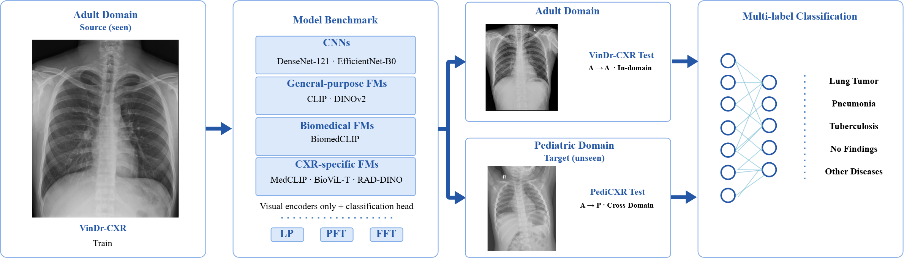

# From Adults to Children: Benchmarking Foundation Models for Chest X-Ray Classification under Domain Shift

**Accepted at WACV 2027** | [Paper (arXiv)](https://arxiv.org/abs/2610.21809) | [Supplementary Material](Supplementary/supplementary_material.pdf)

Official code repository for **"From Adults to Children: Benchmarking Foundation Models for Chest X-Ray Classification under Domain Shift"**.

## 🔍 Overview

This benchmark evaluates **six foundation models and two conventional CNNs** for multi-label chest X-ray classification under an **adult-to-pediatric domain shift**. Models are trained or adapted exclusively on the adult **VinDr-CXR** dataset and evaluated on the held-out adult **VinDr-CXR** test set (*A → A*) and the pediatric **PediCXR** test set (*A → P*). **No pediatric images are used for downstream training or model selection.**



*Overview of the benchmark workflow.*

We compare three adaptation strategies: **linear probing (LP)**, which updates only the classification head; **partial fine-tuning (PFT)**, which updates selected final encoder layers and the classification head; and **full fine-tuning (FFT)**, which updates the entire visual encoder and classification head. Each configuration is evaluated over **three random seeds**.

## 🧠 Models

| | DenseNet-121 | EfficientNet-B0 | CLIP | DINOv2 | BiomedCLIP | MedCLIP | BioViL-T | RAD-DINO |
|---|---|---|---|---|---|---|---|---|
| **Implementation** | [Link](https://docs.pytorch.org/vision/stable/models/generated/torchvision.models.densenet121.html) | [Link](https://docs.pytorch.org/vision/stable/models/generated/torchvision.models.efficientnet_b0.html) | [Link](https://github.com/openai/CLIP) | [Link](https://github.com/facebookresearch/dinov2) | [Link](https://huggingface.co/microsoft/BiomedCLIP-PubMedBERT_256-vit_base_patch16_224) | [Link](https://github.com/RyanWangZf/MedCLIP) | [Link](https://github.com/microsoft/hi-ml/tree/main/hi-ml-multimodal) | [Link](https://huggingface.co/microsoft/rad-dino) |

For multimodal foundation models, only the **visual encoder** is used for downstream classification.

## ⚙️ 1. Installation

The experiments were implemented in **PyTorch**, using separate **Conda environments** to accommodate model-specific dependencies. DenseNet-121 and EfficientNet-B0 share the `cnns` environment.

**Step 1 — Clone the repository:**

```bash
git clone https://github.com/sarainacio/Adult-to-Pediatric-CXR-Benchmark.git
cd Adult-to-Pediatric-CXR-Benchmark
```

**Step 2 — Create and activate a dedicated Conda environment:**

Create a separate environment for the model you want to use, with the Python version specified in its corresponding `Environments/*.yml` file. DenseNet-121 and EfficientNet-B0 share the `cnns` environment. For example:

```bash
conda create -n cnns python=3.10
conda activate cnns
```

**Step 3 — Install the original model implementation:**

Follow the installation instructions in the [Models](#models) section for the selected upstream implementation, including any required packages or pretrained model downloads. Perform these steps inside the activated Conda environment.

**Step 4 — Check the experimental dependencies:**

The `Environments/*.yml` files contain the package versions used in the experiments and are provided for reproducibility. These files can also be used to recreate the corresponding Conda environments as an alternative to manual installation. GPU/CUDA compatibility may require additional adjustments.

## 💾 2. Dataset Preprocessing

The VinDr-CXR images were converted from DICOM to compressed NumPy (`.npz`) format using the provided [`dicom_conversion_npz.py`](Dataset/dicom_conversion_npz.py) script, preserving their original resolution. Additional model-specific preprocessing is performed within the training and evaluation scripts.

## 🚀 3. Training

Each model directory contains separate training scripts for the three adaptation strategies:

- **LP:** linear probing
- **PFT:** partial fine-tuning
- **FFT:** full fine-tuning

All models are trained using the adult VinDr-CXR training data. The same adult training/validation split is used across models and strategies, and the best checkpoint is selected using the **adult validation Macro-AUROC**. Each experiment is repeated with **three random seeds**.

**Important:** Paths are defined separately in each Python file. **Before running any training script, manually update its dataset paths, pretrained-weight paths (if applicable), checkpoint paths, and output directories** to match your local filesystem. Changes made in one script do not automatically update the others.

Navigate to the relevant model directory and run the Python script corresponding to the desired adaptation strategy (LP, PFT, or FFT). Script names may differ between models; use the filenames provided in each directory.

For full details of the training protocol and hyperparameters, refer to the [paper](https://arxiv.org/abs/2610.21809).

## 📊 4. Evaluation

Each model directory includes evaluation scripts for both **individual checkpoints** and **the three-seed evaluation**.

Models are evaluated without additional training on:

- **VinDr-CXR test set (A → A):** in-domain evaluation on adult images.
- **PediCXR test set (A → P):** cross-domain evaluation on pediatric images.

The evaluation reports **Macro-AUROC**, **mean Average Precision (mAP)**, and **Macro-F1**, with the results summarized as **mean ± standard deviation over three seeds**. The domain-shift gap is defined as:

```text
ΔAUROC = Macro-AUROC (A → A) − Macro-AUROC (A → P)
```

**As with training, manually adjust the dataset and checkpoint paths in each evaluation Python file before execution**, including the individual-checkpoint and three-seed evaluation scripts. Paths are script-specific; updating one file does not update the others. Run the evaluation script available in the corresponding model directory.

## 💾 5. Model Checkpoints

The **trained model checkpoints** corresponding to the experiments are stored on OneDrive due to their file sizes and are **available upon request**. They are not included in this GitHub repository.

For access instructions, see the [Model Checkpoints README](Checkpoints/README.md), or contact **[sara.inacio@ubi.pt](mailto:sara.inacio@ubi.pt)** directly.

## 📎 6. Supplementary Material

The [supplementary material](Supplementary/supplementary_material.pdf) accompanies the paper and provides additional details on dataset screening, label distributions, and experimental results.

## 📖 7. Citation

If you use this repository or benchmark in your work, please cite our paper:

```bibtex
@misc{inacio2026adultpediatric,
  title={From Adults to Children: Benchmarking Foundation Models for Chest X-Ray Classification under Domain Shift},
  author={Inacio, Sara and Proenca, Hugo and Neves, Joao C.},
  year={2026},
  eprint={2610.21809},
  archivePrefix={arXiv},
  primaryClass={cs.CV}
}
```

*The citation will be updated with the official WACV 2027 proceedings entry when available.*
